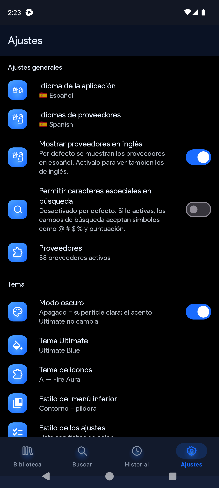

# 本 QuickNovel Ultimate

> Search, read, listen, and download novels — free, ad-free, open source.

| 🌐 Docs language | 🔗 Link |
|------------------|---------|
| 🇪🇸 Español | [Full manual](docs/manual-1.2.3/es/) |
| 🇬🇧 English | [Full manual](docs/manual-1.2.3/en/) |
| 🇷🇺 Русский | [README_RU](README_RU.md) |

Fork of [QuickNovel](https://github.com/LagradOst/QuickNovel) with Ultimate branding, themes, Import-B, Sections, custom providers, LNReader plugins, and stronger QA.

---

## ⚡ At a glance

| | |
|---|---|
| 🏷️ **Version** | **2.0.1** (`versionCode` 201) |
| 📦 **Package** | `com.lagradost.quicknovel.ultimate` |
| 🌙 **Defaults** | Dark mode **ON** · **Ultimate Blue** · English providers **ON** |
| 📥 **Download** | [Releases](https://github.com/RaffyRod/NovelReader/releases) · universal APK · or run **Release → Telegram** (manual) |
| 🧑‍💻 **Repo** | https://github.com/RaffyRod/NovelReader |
| ⬆️ **Upstream** | https://github.com/LagradOst/QuickNovel |

### ✅ First steps (2 minutes)

| Step | What to do |
|------|------------|
| 1️⃣ | Uninstall older Ultimate / stock QuickNovel if present |
| 2️⃣ | Install `QuickNovel-Ultimate-2.0.1-universal.apk` |
| 3️⃣ | If prompted to update to LagradOst 3.x → **Cancel / Skip** |
| 4️⃣ | Open **QuickNovel Ultimate** (orb + 本) |
| 5️⃣ | App language defaults to **Español** (change in Settings) |

> 💡 Tip: if you see two “QuickNovel” icons, always use **Ultimate**.

---

## ✨ Features

| Area | What you get |
|------|----------------|
| 🎨 **Look** | Ultimate Blue + dark mode by default; 11 accent packs; icon styles A–J; bottom-nav / settings styles |
| 📚 **Library** | Local search, follow, shelves rail, Import-B (**EPUB / PDF**) |
| 🧭 **Sections** | Library shelves + **Traducciones** (Material Translate icon) |
| 🕘 **History** | **Reading** / **Visited** with date groups |
| 🔎 **Search** | Multi-provider, chips, special chars blocked by default; English sources on by default |
| 🔌 **Sources** | Built-in sites + custom Blog/Madara + **LNReader plugins** |
| 🖼️ **Covers** | Title-as-cover placeholder (theme + language) when art is missing |
| 📖 **Reader** | **Glyph Pulse** (本) while loading — themed, UI language, no raw URL |
| ⬇️ **Download** | Ranges, chapters/file, language via Gemini / Google / Original |
| 🔊 **TTS** | Piper/Sherpa voices (Dave ES / Lessac EN) + notification |
| 🧪 **QA** | Unit + Appium E2E (specs 01–15) + CI validate → unit → smoke / features* / providers / reader |

---

## 🚀 What’s new in 2.0.1

### Added / fixed
| | |
|---|---|
| Catalog select-all | Visible **Seleccionar todos / ninguno** (was a hidden dialog button) |
| Name-only filter | Catalog search matches **name** only · paging hint for all 300+ sources |
| Proveedores propios | Scrollable manager — no ~56-item `setItems` cap |
| Madara / Blog | No auto-CSS from catalog; add via **URL/JSON** as before |
| Settings groups | Accent **rail** headers · **Tutorial** under Información |
| Plugin install | **Glyph Pulse (本)** loading while fetching plugins |
| Plugin search | Live filter in hub / catalog / proveedores |
| CI → Telegram | Release builds/sends APK only after green **CI Android** (e2e) on main |
| E2E / CI | Specs 01–15 · features split + system-image/AVD cache + x86_64 APK (~10m warm) |

Full history → [`CHANGELOG.md`](CHANGELOG.md)

---

## 📱 Screenshots

_Captured on **2.0.0** (Ultimate Blue · dark mode · Español)._

| Biblioteca | Buscar |
|:---:|:---:|
|  |  |
| Import EPUB/PDF · local search | Populares + multi-provider grid |

| Resultados | Secciones |
|:---:|:---:|
|  |  |
| Results grouped by source | Library rail · Descargas · Traducciones |

| Historial | Ajustes |
|:---:|:---:|
|  |  |
| Reading / visited empty state | Language · English providers · themes |

| Proveedores | |
|:---:|:---:|
|  | |
| Multi-select · flags · Select all / none | |

More shots → [`docs/manual-1.2.3/es/imagenes/`](docs/manual-1.2.3/es/imagenes/) · mocks → [`docs/previews/`](docs/previews/)

---

## 📖 Manuals & tutorials

| 🌍 | Format | Path |
|----|--------|------|
| 🇪🇸 | HTML + Word + bug template | [`docs/manual-1.2.3/es/`](docs/manual-1.2.3/es/) |
| 🇬🇧 | HTML + Word + bug template | [`docs/manual-1.2.3/en/`](docs/manual-1.2.3/en/) |
| 🗂️ | Docs index | [`docs/README.md`](docs/README.md) |
| 🎨 | HTML mocks (themes, Glyph Pulse, settings headers, plugins…) | [`docs/previews/`](docs/previews/) |

In-app: **Settings → Información → Tutorial** (Providers · Downloads · TTS).

Typical Desktop pack: `QuickNovel-Ultimate-2.0.1/` (APK on Desktop). Manuals folder remains `docs/manual-1.2.3/` until the next doc regen.

---

## 🛠️ Quick build

```bash
./gradlew :app:assembleRelease
```

| Command | Purpose |
|---------|---------|
| `./gradlew :app:assembleRelease` | Release APK |
| `./gradlew :app:testDebugUnitTest` | Unit tests |
| `cd e2e && npm test` | Full E2E suite |
| `npm run test:smoke` (in `e2e/`) | Smoke 01–04 |
| `npm run test:features-plugins` | Plugins + catalog (10, 15) |
| `npm run test:features-flows` | Download translate + sections (11, 14) |
| `python docs/manual-1.2.3/_generar_docs_en.py` | Regenerate EN manual |

Sign the universal APK under `app/build/outputs/apk/release/` or use the Desktop build.  
Telegram release (manual): **Actions → Release → Telegram → Run workflow**.  
E2E details → [`e2e/README.md`](e2e/README.md) · CI → [`.github/workflows/e2e-android.yml`](.github/workflows/e2e-android.yml)

---

## 🧰 Stack (summary)

| Layer | Tech |
|-------|------|
| 💻 Language | Kotlin |
| 🖼️ UI | Jetpack Compose (M3) + legacy Views |
| 🌐 Network | OkHttp / NiceHttp, Jsoup |
| 🖼️ Images | Coil 3 |
| 📖 Reader | EPUB + PDFBox |
| 🔊 TTS | Android TTS + Sherpa/Piper |
| 🌐 Translation | ML Kit + optional Gemini |
| 🧪 Tests | JUnit · WebdriverIO 9 · Appium · Allure |

---

## 🌐 Providers

Includes sources such as SkyNovels, Nova, DevilNovels, Royal Road, Scribblehub, NovelFull, and more (`Apis.kt`).  
Also: **custom providers** (Blog / Website) and **LNReader plugins** from Settings.

---

## 👏 Credits

Based on QuickNovel by [LagradOst](https://github.com/LagradOst/QuickNovel).  
Upstream Discord: https://discord.gg/5Hus6fM

---

## ⚖️ Legal notice

Any legal issues regarding the content on this application should be taken up with the actual file hosts and providers themselves as we are not affiliated with them.

In case of copyright infringement, please directly contact the responsible parties or the streaming websites.

The app is purely for educational and personal use.

QuickNovel does not host any content on the app, and has no control over what media is put up or taken down. QuickNovel functions like any other search engine, such as Google. QuickNovel does not host, upload or manage any videos, films or content. It simply crawls, aggregates and displays links in a convenient, user-friendly interface.

It merely scrapes 3rd-party websites that are publicly accessible via any regular web browser. It is the responsibility of the user to avoid any actions that might violate the laws governing his/her locality. Use QuickNovel at your own risk.
