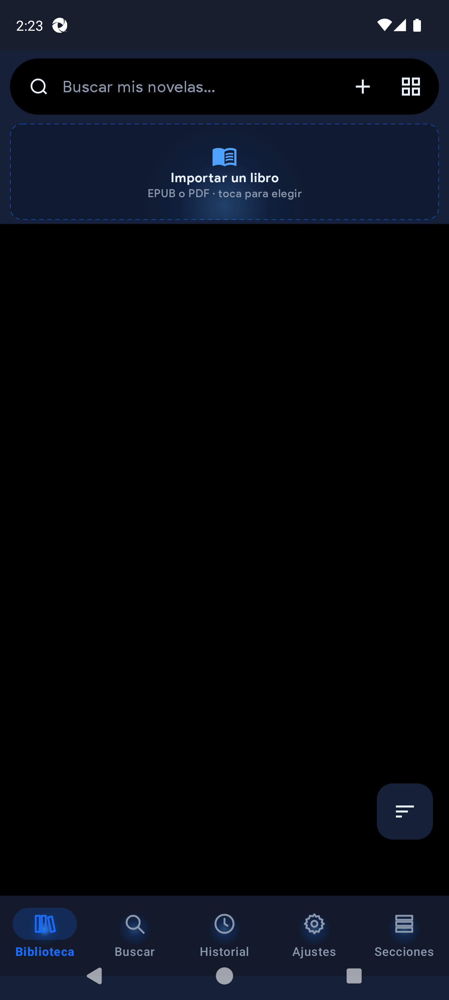
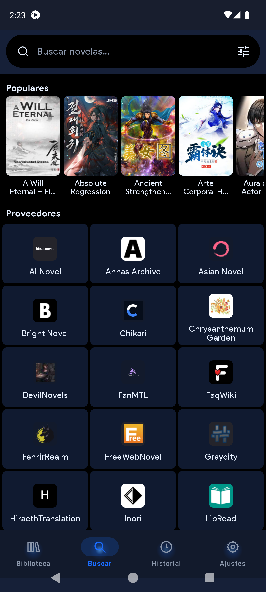
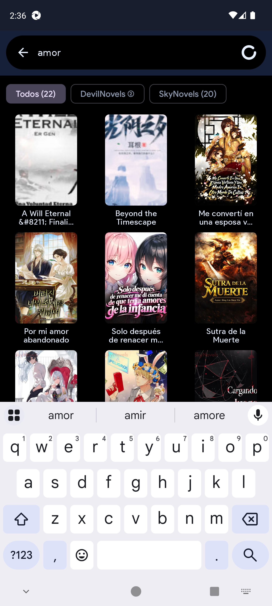
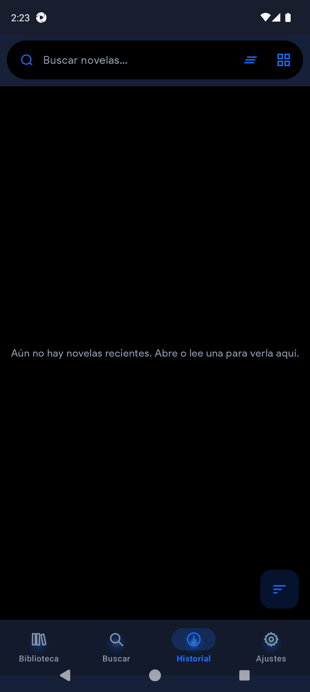
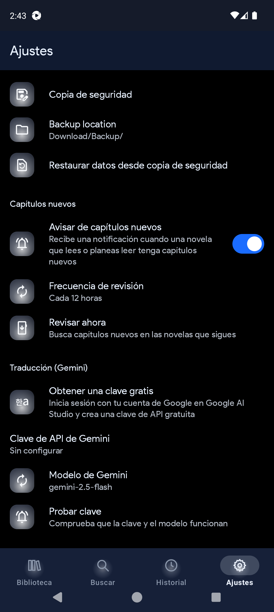
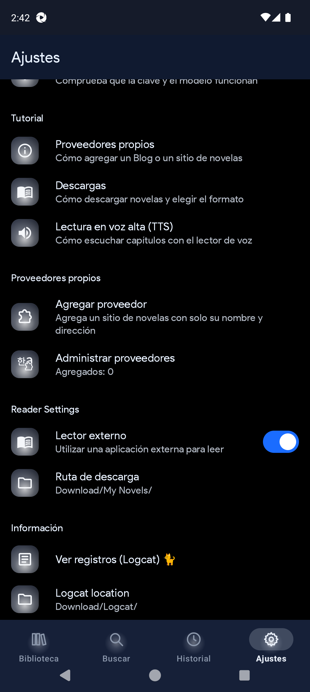
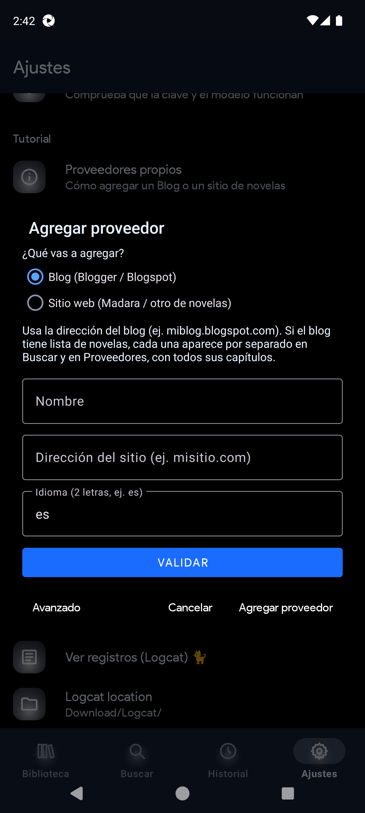
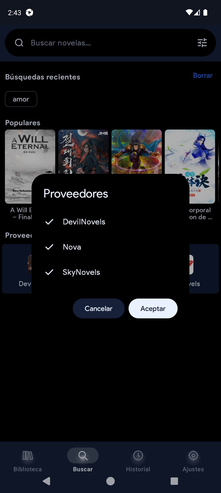

# QuickNovel Ultimate

**English** · [Español manuals](docs/manual-1.1.4/es/) · [English manuals](docs/manual-1.1.4/en/) · [Русский](README_RU.md)

Ad-free FOSS Android app to **search, read, listen (TTS), download and import** novels.  
Fork of [QuickNovel](https://github.com/LagradOst/QuickNovel) with Ultimate branding, Fire themes, custom providers, Import-B, Sections, and stronger QA.

| | |
|---|---|
| **Repo** | https://github.com/RaffyRod/NovelReader |
| **Upstream** | https://github.com/LagradOst/QuickNovel |
| **Version** | **1.1.4** (`versionCode` 114) |
| **App ID** | `com.lagradost.quicknovel.ultimate` |
| **Download** | [Releases](https://github.com/RaffyRod/NovelReader/releases) · universal APK (`arm64-v8a` / `armeabi-v7a` / `x86_64`) |

---

## Features & improvements (Ultimate)

### Brand & UI
- **Ultimate Blue** default look; launcher branding (orb + 本)
- **Fire themes** (Blue / Black / Lava) shared by settings icons, bottom nav, Sections, and launcher aliases
- Nav / settings style variants; rating format options
- Locales: **Español** (default), English, Türkçe, Русский

### Library & reading
- **Biblioteca** with pinned local search, continue reading, follow, sort FAB
- **Import-B** Fire drop-zone for **EPUB / PDF**
- **Secciones** tab — library shelves (Ultimate-only)
- **Historial** split into **Leyendo / Visitadas** with date groups
- In-app reader + optional external reader; chapter download ranges & chapters-per-file batches
- Chapter list without noisy release timestamps under each row

### Search & providers
- Online search across built-in providers + **user-defined** sources
- Provider **multi-select** dialog to search several sources at once
- Result chips filter by provider; cover size aligned with Popular
- **Special characters blocked by default** in search fields; enable in Settings
- **Custom providers**: Blog (Blogger) or Website (Madara) — simple validate flow + **Advanced CSS** mode, manage/edit/delete
- **Plugins (LNReader)**: Settings hub to add a `plugins.min.json` catalog, filter by language, install/update/uninstall sources as searchable providers

### Downloads & chapter select
- Download dialog: range, chapters-per-file (EPUB/PDF), **download language** (default Español) via **Gemini** or **Google Translate online**, or keep Original
- Translated downloads are verified so the saved file is not the silent original
- Chapter tab: icon-only **Select** FAB with **Halo ring** stroke/glow from each theme’s `colorPrimary`

### TTS & translation
- **TTS** prefers Piper/Sherpa neural voices (**Dave ES** / **Lessac EN**), language from text, notification controls
- Optional **Gemini** API key / model for translation flows (also used from the download dialog)

### Updates & safety
- Auto check against upstream LagradOst releases **disabled by default** (avoids installing stock `com.lagradost.quicknovel` 3.x beside Ultimate)
- Backup / restore, download path, logcat viewer

### Docs & QA
- Full manuals **ES + EN** (HTML + Word + bug templates + screenshots): [`docs/manual-1.1.4/`](docs/manual-1.1.4/)
- UI previews (plugins flow, Select FAB styles): [`docs/previews/`](docs/previews/) · docs index: [`docs/README.md`](docs/README.md)
- Unit tests (Gradle) + **WebdriverIO / Appium / Allure** E2E suite (`e2e/`, specs **01–11**)
- CI on every push: [`.github/workflows/e2e-android.yml`](.github/workflows/e2e-android.yml)

---

## Screenshots (Ultimate 1.1.4)

<p>




</p>
<p>




</p>

More shots: [`docs/manual-1.1.4/es/imagenes/`](docs/manual-1.1.4/es/imagenes/)

---

## Tech stack

| Layer | Stack |
|-------|--------|
| Language | **Kotlin**, JVM 11 |
| UI | **Jetpack Compose** (Material 3) + legacy Views/Fragments where still in use |
| Architecture | ViewModels, coroutines, WorkManager |
| Networking | NiceHttp / OkHttp, Jsoup scraping |
| Images | Coil 3 |
| Storage | PreferenceStore, SafeFile / simple-storage, Room-adjacent download DB flows |
| Reader | EPUB tooling, PDFBox Android |
| TTS | Android TTS + Sherpa/Piper preference |
| Translation | ML Kit Translate + optional Gemini HTTP |
| Markdown | Markwon |
| Build | Android Gradle Plugin, Compose compiler, ABI splits + universal APK |
| Tests | JUnit (unit), AndroidX instrumentation, **WebdriverIO 9 + Appium UiAutomator2 + Mocha + Allure** |

---

## Tools

| Tool | Use |
|------|-----|
| Android Studio / SDK + `adb` | Build, install, emulator |
| `./gradlew :app:assembleRelease` | Release APK |
| `./gradlew :app:testDebugUnitTest` | Unit tests |
| Node 18+ / npm (`e2e/`) | E2E automation |
| Appium + UiAutomator2 | Device driver |
| Allure | E2E HTML reports |
| `docs/manual-1.1.4/_generar_docs_es.py` / `_generar_docs_en.py` | Regenerate manuals (HTML/DOCX) |
| GitHub Actions | Emulator CI + Allure artifacts |

---

## Build

```bash
./gradlew :app:assembleRelease
```

Sign the universal APK under `app/build/outputs/apk/release/` (or use your Desktop `QuickNovel-Ultimate-1.1.4-universal.apk`).  
Uninstall older Ultimate/stock packages on the device before installing so you always run the latest.

---

## User manuals (ES / EN)

| Lang | Folder |
|------|--------|
| Español | [`docs/manual-1.1.4/es/`](docs/manual-1.1.4/es/) |
| English | [`docs/manual-1.1.4/en/`](docs/manual-1.1.4/en/) |
| Index | [`docs/manual-1.1.4/README.md`](docs/manual-1.1.4/README.md) |

Includes onboarding, every Settings group, **custom providers (simple + advanced)**, **LNReader plugins**, download language / translate engines, TTS/download tutorials, bug Word templates, and screenshots.

Interactive HTML mocks: [`docs/previews/`](docs/previews/).

---

## E2E automation

See [`e2e/README.md`](e2e/README.md).

```bash
cd e2e
npm install
npm test
npm run allure:report
```

Coverage: library, navigation, search (+ special chars), history, settings, Import-B, **reader + TTS** (seeded — no skips), providers (HTTP probe + multi-select), **plugins hub**, **download language / translate**.

---

## Built-in providers (sample)

Includes sources such as SkyNovels, Nova, DevilNovels, Royal Road, Scribblehub, NovelFull, and many more (see app / `Apis.kt`).  
Plus **user-defined** Blog / Website providers and **LNReader plugins** from Settings.

---

## Credits

Based on QuickNovel by [LagradOst](https://github.com/LagradOst/QuickNovel). Upstream Discord: https://discord.gg/5Hus6fM

## Legal notice

Any legal issues regarding the content on this application should be taken up with the actual file hosts and providers themselves as we are not affiliated with them.

In case of copyright infringement, please directly contact the responsible parties or the streaming websites.

The app is purely for educational and personal use.

QuickNovel does not host any content on the app, and has no control over what media is put up or taken down. QuickNovel functions like any other search engine, such as Google. QuickNovel does not host, upload or manage any videos, films or content. It simply crawls, aggregates and displays links in a convenient, user-friendly interface.

It merely scrapes 3rd-party websites that are publicly accessible via any regular web browser. It is the responsibility of the user to avoid any actions that might violate the laws governing his/her locality. Use QuickNovel at your own risk.
